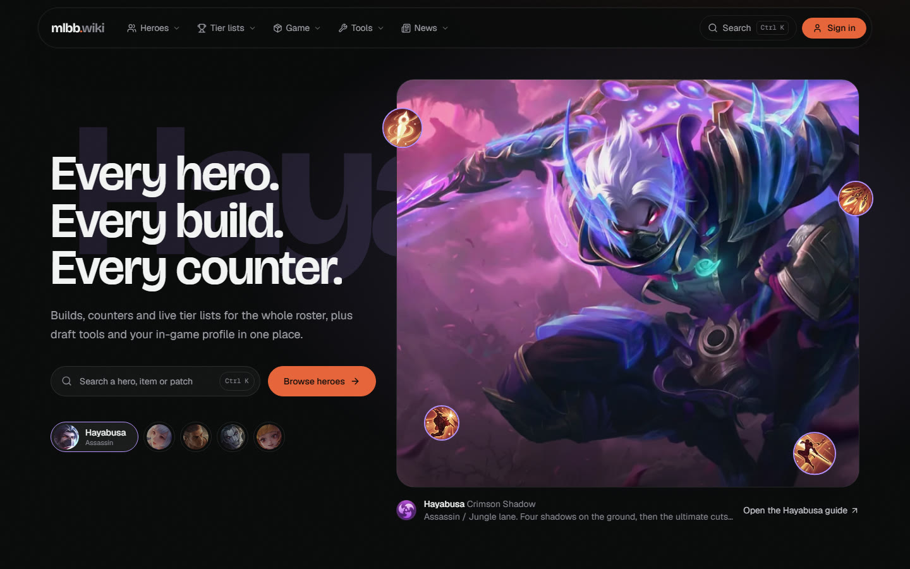
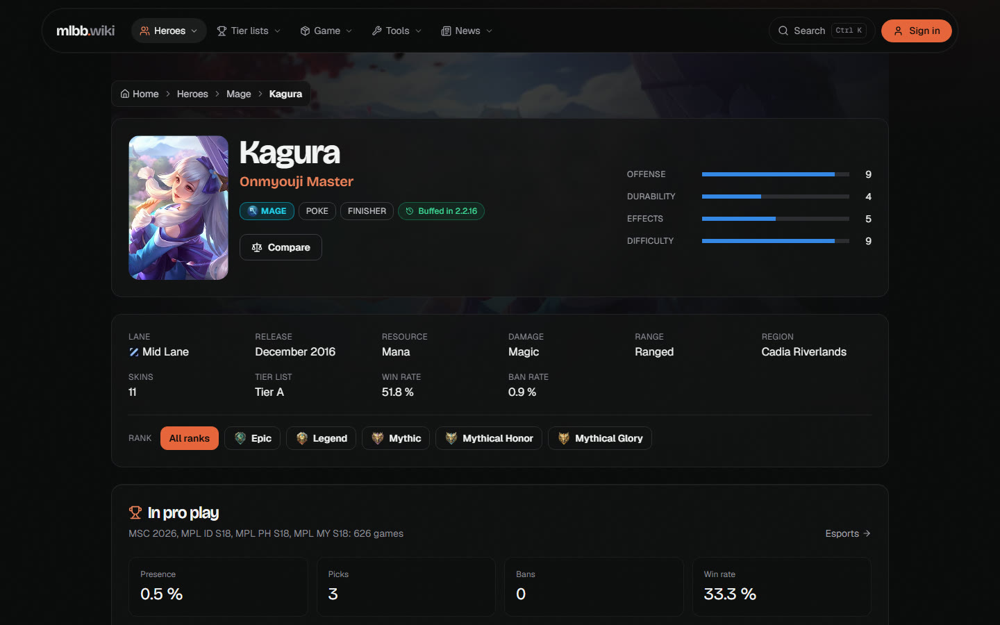
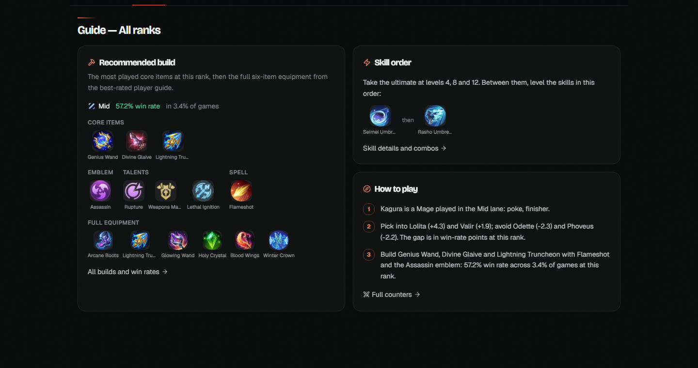
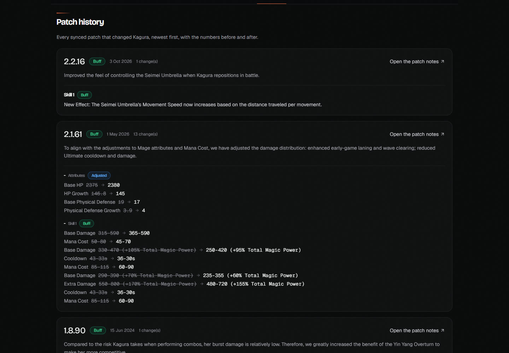
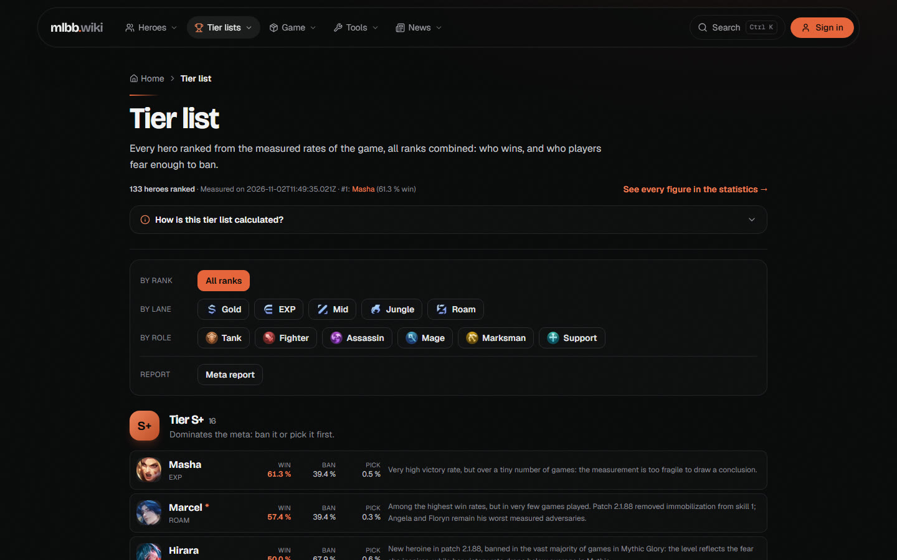
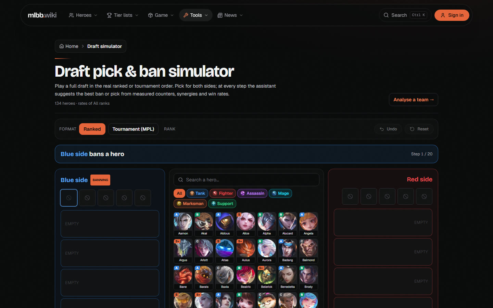
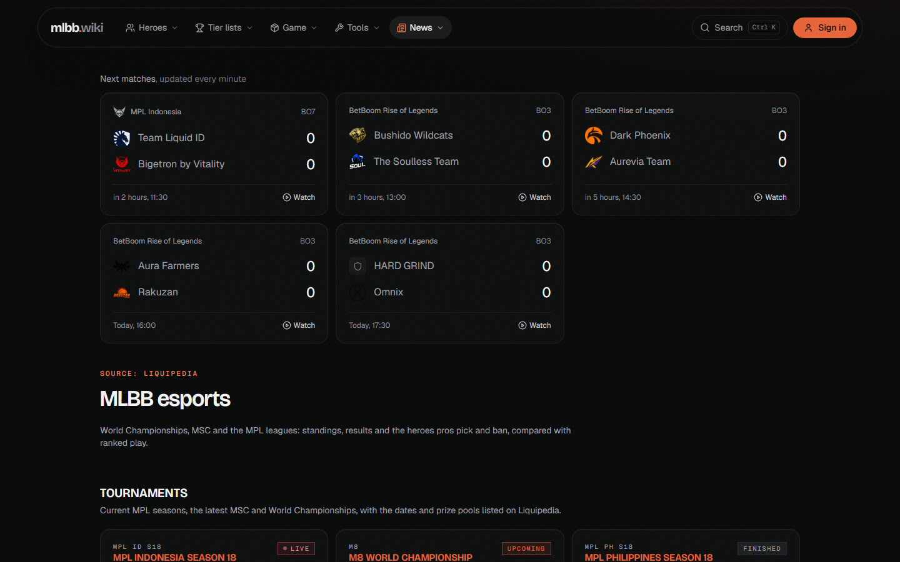
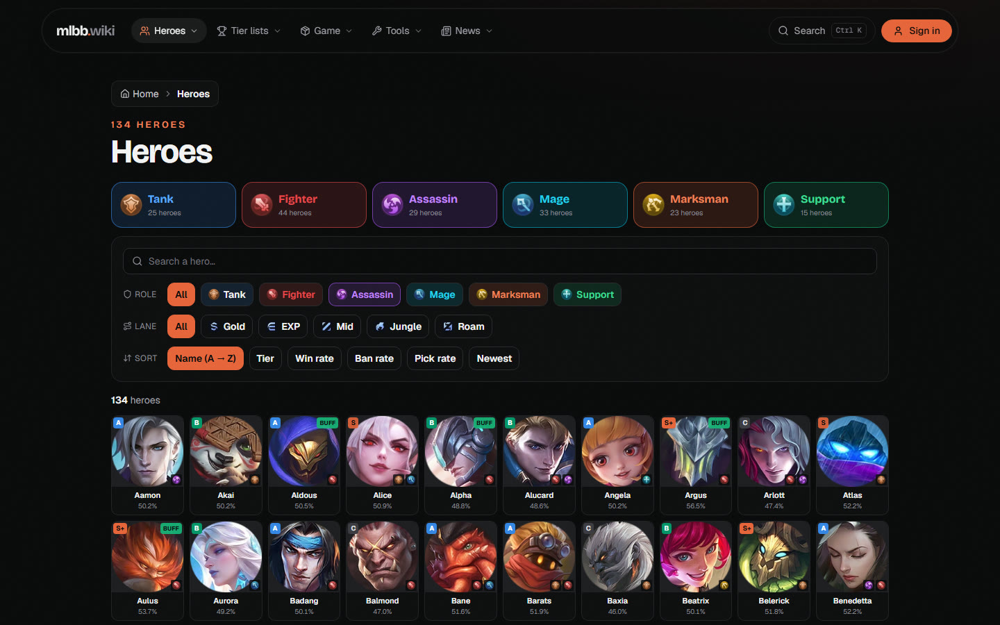
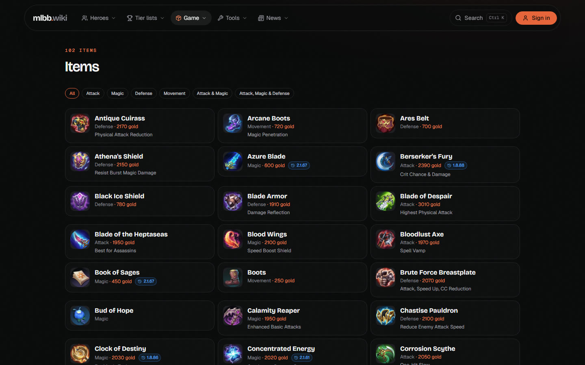
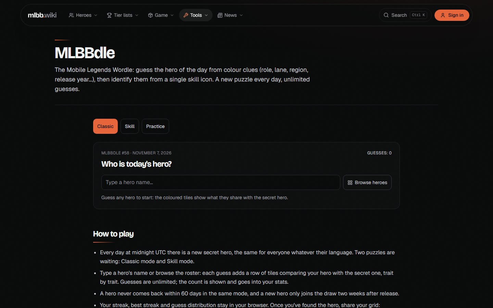

<p align="center">
  
</p>

<h1 align="center">mlbb.wiki</h1>

<p align="center">
  Every hero. Every build. Every counter.<br />
  A community wiki, tier list and toolbox for <strong>Mobile Legends: Bang Bang</strong>, built from the game's own numbers.
</p>

<p align="center">
  <a href="https://mlbbwiki.vercel.app">Live site</a> ·
  <a href="#features">Features</a> ·
  <a href="#where-the-data-comes-from">Data</a> ·
  <a href="#run-it-locally">Run it locally</a> ·
  <a href="#contributing">Contributing</a>
</p>

<p align="center">
  
  
  
  
  
</p>



## What it is

mlbb.wiki is a fan-made site for Mobile Legends players who want answers between two matches: which heroes win right now, what to build on them, who counters whom, what the last patch changed, and when the next pro match starts.

Everything on the site is measured or sourced, never guessed. Win, pick and ban rates come from ranked play and are broken down by rank. Patch changes are the official notes, restructured per hero and per item. Pro drafts come from the leagues. Hand-written analysis sits on top of that data, clearly separated from it.

The site has no signup and no database. The optional sign-in uses your Player ID and the game's own verification code, and the session lives in your browser.

## Features

### Hero pages

Every one of the game's 130+ heroes has a page with its skills, lore, skins, measured counters and best teammates, the builds actually played at each rank, pro-play presence, and the hero's full patch history.



**Guide tab.** One recommended build for the rank you select (the most played core items plus a top-rated player's full six-item equipment), the skill level-up order, and three "how to play" tips built from the hero's lane, matchups and build.



**Patch awareness.** A badge says when the hero was last buffed, nerfed or adjusted. The Patches tab lists every synced patch that touched the hero with the numbers before and after, so you never have to dig through a whole patch note.



### Tier list and statistics

Heroes ranked from the game's measured win, ban and pick rates, filterable by rank, lane and role, with a short note on each hero and a meta report. The statistics page has every figure behind it.



### Draft simulator and team tools

Play a full ranked or tournament (MPL) draft for both sides. At every step the assistant suggests the best ban or pick from measured counters, synergies and win rates. Compare two heroes side by side, or check a five-hero lineup in the team builder.



### Esports

Next matches updated every minute, live and upcoming tournaments, standings, results, and the heroes pros pick and ban compared with ranked play. Pro teams and players have their own pages.



### Heroes, items and game knowledge





The items page shows each item's stats, passives and recipe, plus the patches that changed it. Emblems, battle spells, skins with a release calendar, lore by region, game modes, patch notes and news (including the Advance Server) complete the picture.

### Tools

- **Win rate calculator**: how many wins you need to reach a target rate.
- **Server time**: the current time on every server, with the next resets.
- **Objective timer**: Turtle, Lord and buff respawns during a match.
- **Draw calculator**: odds, expected cost and milestones of a draw event.
- **Retribution test** and **collection value calculator**.
- **Tier list maker**: your own ranking, shared by link or exported as an image.
- **MLBBdle**: guess the hero of the day from colour clues or a single skill icon.



### Your account

Sign in with your Player ID and Server ID. The game mails a 4-digit code to your in-game inbox; no password, no signup. You then get your profile (name, avatar, level, current and highest rank, region), your friend list, a shareable lobby card, and scrims: lobbies where creators invite players and record results.

## Where the data comes from

| Data | Source | How it is refreshed |
| --- | --- | --- |
| Heroes, skills, skins, items, patch notes | Mobile Legends wiki (Fandom) | `npm run sync` (full or daily), stored in `src/data/game/` |
| Win, pick and ban rates, counters, builds, player guides | In-game ranked statistics | same sync, broken down by rank |
| Esports tournaments, matches, pro drafts | Liquipedia (CC BY-SA 3.0) | `npm run sync:esports` |
| Pro teams, players and live matches | PandaScore API | serverless routes under `/api` |
| Events and skin calendar | Game events feed | `npm run sync:events` |
| Advance Server notes, news | Official channels | `npm run sync:advance-server`, `npm run watch:news` |
| Player account | The game's account API, proxied by `/api/mlbb-*` | live, on sign-in |

Hand-written hero analyses (summary, strengths, weaknesses, annotated builds, skill order, tips) live in `src/data/wiki/heroes/` and are layered on top of the synced data by hero slug.

## Tech stack

- **React 18 + TypeScript + Vite**, Tailwind CSS 3, React Router.
- **Design:** Bricolage Grotesque and Geist, self-hosted via Fontsource. One graphite scale, one ember accent, defined in `tailwind.config.js`.
- **Motion:** GSAP with ScrollTrigger; Lenis smooth scrolling on the home page only. Everything respects `prefers-reduced-motion`.
- **Serverless (Vercel):** a single function, `api/[route].ts`, dispatches every `/api/<name>` call to `api/_routes/<name>.ts` (account proxy, pro data, live esports, nickname lookup, wiki data).
- **Android:** the same build ships as an app through Capacitor (`npm run android:sync`).

## Run it locally

```bash
npm install
npm run dev      # http://localhost:5174
```

In development the `/api/mlbb-*`, `/api/pro-*` and `/api/esports-*` handlers run inside Vite (see `vite.config.ts`) and `/api/nickname` is proxied to its upstream, so no extra process is needed. Put a `PANDASCORE_TOKEN` in `.env.local` if you want pro teams, players and live matches.

Other scripts:

```bash
npm run build            # typecheck, build, prerender meta tags per page
npm run sync             # refresh heroes, items, skins, patches and statistics
npm run sync:esports     # refresh tournaments and matches from Liquipedia
npm run android:sync     # build and copy into the Android project
```

## Sign-in, step by step

1. The visitor enters a Player ID and Server ID; `/api/mlbb-send-code` asks the account API to mail a 4-digit code to the in-game inbox.
2. `/api/mlbb-verify` exchanges the code for a session token and returns the profile.
3. The token and a profile snapshot are saved in `localStorage` (`src/lib/auth.tsx`). On every visit `/api/mlbb-refresh` updates the snapshot; a 401 means the token expired and the visitor signs in again.
4. `/profile` shows the profile and the friend list (`/api/mlbb-friends`).

The account routes call [mlbb.bypaxxy.rip](https://mlbb.bypaxxy.rip/) through `api/_bypaxxy.ts`; override the base URL with the server-side variable `MLBB_API_BASE`. Upstream limits per IP: 5 code requests, 10 logins and 30 data calls per minute.

## Deploy (Vercel)

Import the repository; the Vite preset is detected automatically. The whole API is one serverless function, so it fits the Hobby plan's function limit.

| Variable | Needed for |
| --- | --- |
| `PANDASCORE_TOKEN` | Pro teams and players, team logos, live matches |
| `SITE_URL` | Absolute links in share previews, e.g. `https://mlbbwiki.vercel.app` |

## Project layout

```
api/[route].ts             the one serverless function: dispatches /api/<name> to api/_routes/<name>.ts
api/_routes/               route handlers (account proxy, pro data, live esports, nickname, wiki data)
scripts/                   sync scripts that produce src/data/game/
src/data/game/             synced game data (heroes, items, skins, patches, statistics, esports)
src/data/wiki/             hand-written analyses, emblems, tier-list notes
src/lib/                   auth (browser session), motion, wiki data helpers (tier list, patch changes, draft)
src/components/            shell, UI primitives, home sections, hero page sections
src/pages/                 home, sign-in, profile, lobby card, scrims
src/pages/wiki/            heroes, tier lists, items, tools, esports, news
public/visuels/            hero art, skill, item, emblem, talent, spell and rank icons
docs/                      sync and API notes, README screenshots
```

## Contributing

- **Hero analyses** are the easiest place to help: add or improve an entry in `src/data/wiki/heroes/<role>.ts` following the `HeroAnalysis` type. `skillOrder` and `tips` are optional fields the guide tab uses.
- **Data problems** usually come from a sync: run the relevant script and open a pull request with the refreshed `src/data/game/` files.
- Keep the design system: the tokens in `tailwind.config.js`, the shape rules in `src/index.css`, and no new fonts.

## Credits and legal

Mobile Legends: Bang Bang is a trademark of Moonton. This is a community project, not affiliated with or endorsed by Moonton.

Game data and art come from public community sources, esports data from Liquipedia under CC BY-SA 3.0, pro data from PandaScore. The counters and builds-by-rank views were ported from achedon12/mlbb.
